The objective of this file to resume and put together all the files and notes that can be usefull to understand any about the thesis -> **Staging and explainability (features) from multi-modal data (clinical and genomic) for colorectal cancer.** 
# CAP 1  
## Understanding and knowing more easy terms 

At the start i had to understand easy things just as what is the a Clinical data and Genomic and what are the diferences between them.
#### **Clinical** 
Clinical data is what a doctor or hospital records about the patient and the disease:
- age, sex
- where the tumour is (colon or rectum)
- type of tumour under the microscope
- stage, treatment, survival (alive or dead, and for how long)
#### **Genomic data** 
is what a lab measures in the DNA and genes of the tumour itself, from a piece of tumour tissue:

Type  - Plain meaning:
Mutations - Spelling errors in the DNA of a gene (e.g. "KRAS is mutated")
Copy number - Pieces of DNA lost or duplicated (a gene present 0, 1, or more times instead of 2)
Expression - How "active" each gene is (how much it's being used)
Methylation - Chemical "switches" on the DNA that turn genes on or off 
#### **Multimodal** 
just means using both kinds together in one model. My question is whether combining them predicts stage and survival better than either one alone, and which features matter.

My TCGA file has both: clinical columns (age, stage, survival...) and genomic files (mutations, copy number, expression...).

---------

## Reading  and noting references
Here the objective is to read many pdfs that i thought could be relevant for the thesis and answer a few questions. Also in general i decided to put each pdf in a section. Right now i have 6 section  which are by order :

A. Background - Why colorectal cancer matters, and what..
B. Data - Where your data come from and what the columns means
C. Related work - Others who predicted stage or parts of it 
D. Related work - Others who predicted survival
E. Explainability - The methods that explain your models 
F. Methods - How to build and evaluate models properly 

And in a initial part i'm gonna look to answer some of the questions using the references: 
1. A resume/summary
2. What did they want to know?
3. What data did they use? (clinical, genomic, or both? how many patients?)
4. What did they find? (one or two numbers)
5. Do I trust it? (anything strange?)
6. How does it help my thesis? 

##### **A - Background** - Global cancer statistics 2022: GLOBOCAN estimates of incidence and mortality worldwide for 36 cancers in 185 countries - Bray et al. 2024
📄 PDF: `literature/pdf/A - CA A Cancer J Clinicians - 2024 - Bray - Global cancer statistics 2022  GLOBOCAN estimates of incidence and mortality.pdf`

The article presents global cancer statistics by world region for the year 2022 based on updated estimates from the International Agency for Research on Cancer.And here the articles they Estimates over new cases and deaths by cancer type, sex and world region.

**What did they want to know?**
They wanted to study over the cancer problems that we have in our world, explaining it with many numbers and also multiples cancers not only colorectal. Also giving numbers per regions and comparing it. And to have awareness-raising.

**What data did they use?**
They used the International Agency for Research on Cancer data, (based in Lyon, France). Every few years it publishes the number of new cancer cases and cancer deaths for every country in the world. Only problem is that they mostly use data from rich countries and lower data from poor countries, which mean lower data = estimated data. All countries, but less precise where registries are weak.

**What did they find?**
All cancers, 2022: close to 20 million new cases and 9.7 million deaths.
**Colorectal cancer: more than 1.9 million new cases and about 904,000 deaths** — 9.6% of cases and 9.3% of deaths. (here the anal cancer is include in the colorectum)

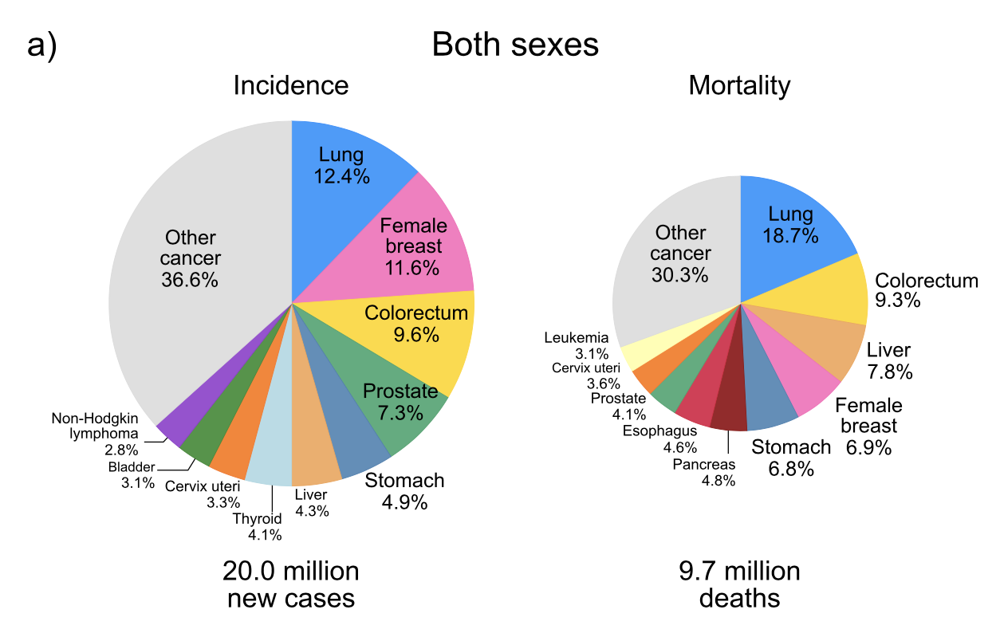

Predictions indicating that the number of new cases of cancer will reach 35 million by 2050, investments in prevention, including the targeting of key risk factors for cancer (including smoking, overweight and obesity, and infection), could avert millions of future cancer diagnoses and save many lives worldwide.

the cumulative risk of men developing cancer before age of 75 years in 2022 ranged from approximately 10% in low HDI settings to over 30% in very high HDI settings. Which means the higher the HDI is the more you might get diagnosed. and Why ? Two possible reasons: more risk factors and older populations in rich countries and second one more screening, so more cancers are found.

**How does it help my thesis?** 
With the numbers that we got, it shows us how severe this problem is. With having Colorectal in 3 places as most commonly diagnosed cancert and second most deathly. And mostly helps us to show us the burden of cancer in our population. 

**Which regions have the most cases? Is rectal cancer different?**

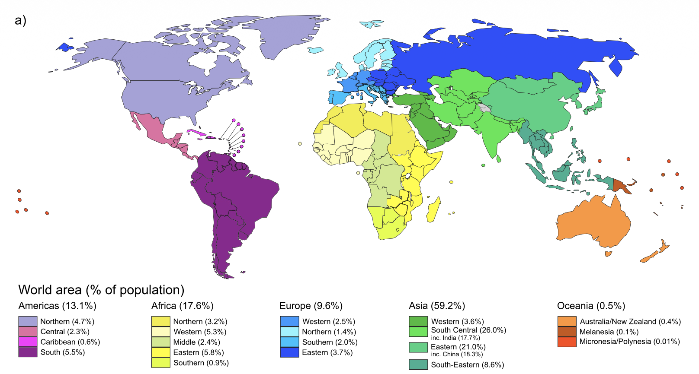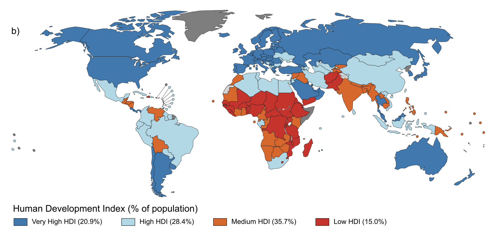

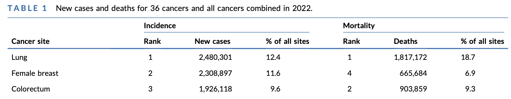

The more the country is develop the more colorectal is higher in the list. Also those stats are really comparable as the population size is way bigger than the the others parts of the world. So its normal to have india and china in first. 

Number of cases: China and India come first, because they have the most people.
Rate per 100,000: Europe, Australia/New Zealand and North America come first. 

That's where the sentence "Denmark and Norway rank first" comes from. The highest rates in Europe, Australia/New Zealand, and Northern America, with Denmark and Norway ranking first in men and women. Counts depend on population size, rates per 100,000 allow fair comparison between countries.

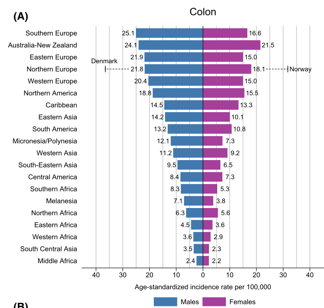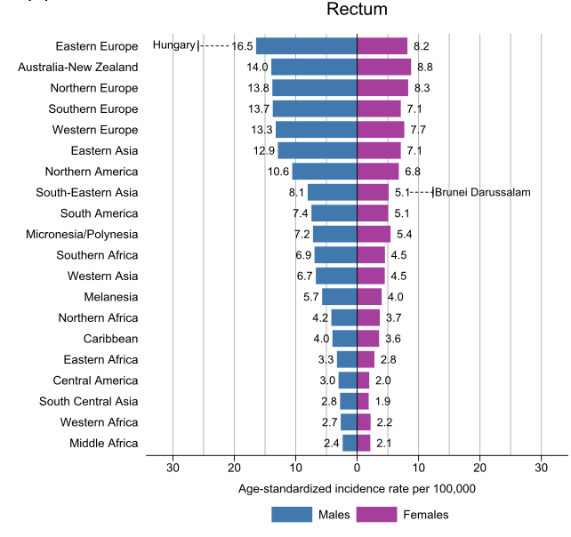

for colon cancer, the highest rates are in Europe, Australia/NZ and North America, and Asia is lower.
for rectal cancer, Eastern Asia (China, Japan, Korea) is among the highest, even above North America.

**Which risk factors (food, lifestyle) do they list? This links to your point about different ways of living, and to Deng later.**
Bray says there is strong evidence for these factors (overall, and protective factors mostly for colon cancer):
Increase risk: alcohol, smoking, red or processed meat, body fat (overweight)
Protect: physical activity , calcium supplements, dairy products, fibre, whole grains

The first sentence says "including anal cancers". Your TCGA data is colon + rectum only. What does that mean when you compare Bray's numbers with your data?
I dont change alot, i just have in mind that there might be some case in the 9.6% that are anal cancers but i know in general he is top 3 world anyways. So Bray's colorectal numbers are slightly higher than colon + rectum alone. When I cite them, I say 'including anal cancer'.

##### **A - Background** -  Colorectal cancer statistics, 2023 - Siegel et al. 2023
📄 PDF: `literature/pdf/CA A Cancer J Clinicians - 2023 - Siegel - Colorectal cancer statistics  2023.pdf`

Related to the The American Cancer Society's three-yearly report on colorectal cancer in the United States: incidence, mortality, stage at diagnosis and survival, with trends by age, subsite and race/ethnicity.

**What did they want to know**
They want to give us an idea/overview on how many people get and die from the colorectal cancer in the US ONLY also gave us many numbers how its progressing.

**What data did they use?**
SEER data which is related to the national cases who track the number of cases in the US. SEER (part of the US) and NAACCR (almost all of the US) for new cases.

**What did they find?**
- The decline in CRC incidence slowed from 3%–4% annually during the 2000s to 1% annually during 2011–2019. 
- The share of cases in people younger than 55 years increased from 11% in 1995 to 20% in 2019.
- A shift to left‐sided tumors, with the proportion of rectal cancer increasing from 27% in 1995 to 31% in 2019. 
- approximately new 153,020 patients in 2023 will be diagnosed with CRC and 52,550 will die from the disease, including 19,550 cases and 3750 deaths in individuals younger than 50 years.
- CRC mortality declined by 2% annually from 2011–2020 overall but increased by 0.5%–3% annually in individuals younger than 50 years
- stage at diagnosis is the most important predictor of survival, with 5‐year relative survival ranging from 91% for localized disease to 14% for distant disease

| SEER stage | Meaning | ≈ AJCC | 5-year survival (all ages) |
|---|---|---|---|
| Localized | Still only in the bowel wall | I–II | 91% |
| Regional | Nearby lymph nodes or nearby tissue | III (plus a few stage II) | 73% |
| Distant | Far organs (liver, lungs…) | IV | 14% |

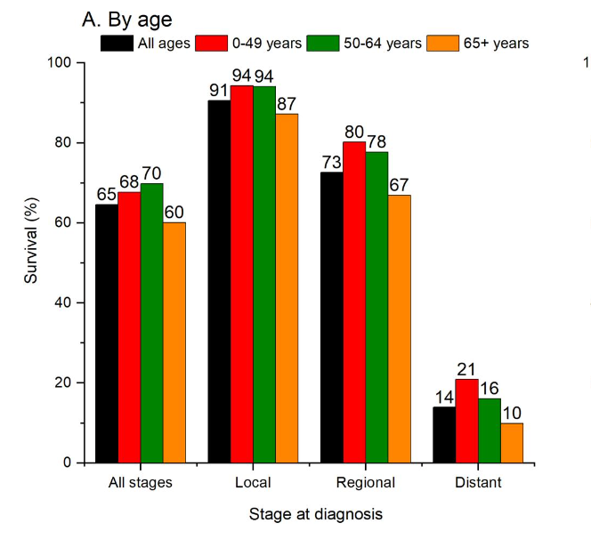

**Do I trust it?**
Yes. It's the American Cancer Society, it uses national data, and it comes out every three years. But US only, so other countries can be different (diet, lifestyle, healthcare). It uses relative survival, but TCGA has overall survival, so I can't compare the numbers directly.

**How does it help my thesis?**
Shows that stage is the strongest predictor of survival, so it's worth predicting stage and survival well. 

##### **A - Background** - AJCC 8th Edition: Colorectal Cancer - Weiser 2018
📄 PDF: `literature/pdf/s10434-018-6462-1.pdf`
Basics of TNM and stages: [[staging-basics]]. What it means for my models: [[thesis-plan]].

**What is the paper about?**
It's about the rules for staging colorectal cancer: what changed in the colorectal chapter of the AJCC 8th edition.

**What did NOT change from the 7th to the 8th edition?**
T and N have not changed from the 7th AJCC édition.

**What changed?**
- M1c added: metastases to the peritoneum, because those patients fare worse than with metastases in other organs.
- Micrometastases in a lymph node now count as positive (N1).
- More discussion of genetic markers, for a personalised approach (see below).

**What are the molecular markers mentioned? Why is that interesting for a thesis using genomic data?**
KRAS, BRAF, NRAS, and MSI / mismatch repair.
- AJCC says they matter, but they're not used to calculate the stage.
- They're in my TCGA data (mutation file; MSI scores in the clinical file: `MSI_SCORE_MANTIS` for 557 patients, `MSI_SENSOR_SCORE` for 584).
- They're known to be linked to the disease (MSI-high tends to be earlier stage, BRAF linked to worse survival), so some signal is expected.

**Classifier vs risk calculator: what's the difference? Which one is TNM?**
- Classifier = puts patients into a few groups (stage I, II, III, IV). Everyone in the same group gets the same prognosis. TNM is a classifier.
- Risk calculator = combines many factors to give each patient their own risk.
- Heterogeneity = patients in the same group are still different. Two stage III patients can have very different survival, and a classifier can't see that.

My survival model is a kind of risk calculator.

**The AJCC rules for a good risk model = checklist for my survival model**

| AJCC rule | What I do or write in the thesis |
|---|---|
| Clear model description | Explain my model and my data (TCGA, colon + rectum) |
| Inclusion/exclusion criteria | Say which of the 594 patients I keep and why (e.g. remove those with no stage or no survival data) |
| List of predictors + how measured | List my features (clinical and genomic) and where they come from |
| Well-defined time zero | Survival counted from diagnosis |
| Proper endpoint | PFI (main) and OS (second): see Liu CDR and [[thesis-plan]] |
| Validation: discrimination | Does the model rank patients correctly (who dies earlier)? C-index |
| Validation: calibration | Are predicted risks close to reality? If it says 30% risk, do about 30% really die? |
| Peer-reviewed article | Doesn't apply to a bachelor thesis |
| Disqualified if short follow-up, missing data not described, few events | Report follow-up length, how much data is missing, and how many deaths in the test set |

**How does it help my thesis?**
- It defines the stage variable I predict.
- It names the genetic markers (MSI, KRAS, NRAS, BRAF) that are outside the stage. That's my research question.
- It explains classifier vs risk calculator: my survival model is a risk calculator, and the AJCC rules are its checklist.

##### **A - Background** - The Eighth Edition AJCC Cancer Staging Manual: Continuing to build a bridge from a population-based to a more "personalized" approach to cancer staging - Amin et al. 2017
📄 PDF: `literature/pdf/CA A Cancer J Clinicians - 2017 - Amin - The Eighth Edition AJCC Cancer Staging Manual  Continuing to build a bridge from a.pdf`
Basics: [[staging-basics]]. Colorectal details: Weiser above.

**What is the paper about?**
The editors of the AJCC staging book explain the whole 8th edition (all cancers): why it was made and its main idea. Weiser is only the colorectal chapter; Amin is the general picture.

**History**
- TNM idea created by Pierre Denoix in the 1940s–1950s.
- AJCC editions: 1st 1977, 2nd 1983, 3rd 1988, 4th 1992, 5th 1997, 6th 2002, 7th 2009, 8th published 2016.
- The 8th was only used from **1 January 2018**. Before that, doctors used the 7th.

**Why does the history matter for me?**
TCGA patients were diagnosed before 2014, so their stage was given with older editions (5th–7th), not the 8th. My labels come from different editions. Grouping into I–II / III / IV keeps me safe, because the borders (nodes, metastasis) stayed the same.

**"Population-based → personalised"**
- Before: stage gave the same prognosis to everyone in the group (population-based).
- Now: the AJCC wants to add other factors (markers, grade…) to give a prognosis closer to each patient (personalised).
- They keep the anatomic stage (T, N, M) as the base, and it can always be used when the extra factors are missing.

**The three kinds of factors in each chapter**

| Kind                          | Meaning                                                                    |
| ----------------------------- | -------------------------------------------------------------------------- |
| Required for stage grouping   | Needed to calculate the stage                                              |
| Recommended for clinical care | Important, but not in the stage. Example for colon: **CEA** (a blood test) |
| Emerging                      | Not enough proof yet; only on the AJCC website                             |

Is CEA in my data? **No**: it's not in the cBioPortal TCGA file. (Hu et al. found it elsewhere, in UCSC Xena.)

**Levels of evidence**
Each rule change has a level of proof: 1 = several big good studies (strongest) … 4 = no proper studies yet (weakest). No stage definition is changed with level 4 evidence.

**Where TCGA is mentioned**
In the section "Prognostic Factors in Cancer: Toward a More Individualized Approach". They say TCGA and similar projects help understand cancer at the molecular level, and that molecular classification will **complement** (not replace) anatomic staging.

**Risk models**
New in the 8th: the AJCC reviews risk models (risk calculators) for official endorsement, using quality rules from the AJCC Precision Medicine Core. Colorectal is one of the first cancers where this is done. These are the rules Weiser lists, which are my checklist for the survival model.

**Do I trust it?**
Yes, it's written by the editors of the official book. Limit: it's about all cancers, so only a few sentences are about colorectal cancer, and it's a commentary, not a study.

**How does it help my thesis?**
- Explains why my stage labels come from older editions (5th–7th) and why the three groups are safe.
- The staging experts themselves say molecular data (they name TCGA) should complement anatomic stage. That's my research idea.
- Supports using AJCC rules as a checklist for my survival model.

##### **A - Background** - Rectal Cancer in Asian vs. Western Countries: Why the Variation in Incidence? - Deng 2017
📄 PDF: `literature/pdf/s11864-017-0500-2.pdf`
Links to Bray (rectal cancer higher in Eastern Asia).

**What is the paper about?**
A review (one author summarising other studies) explaining why rectal cancer is a bigger part of colorectal cancer in Asia than in Western countries, and how colon and rectal cancer differ.

**What part of colorectal cancer is rectal?**
- Europe and North America: less than 40%.
- Asia: 50% or more. In China this share is going down, because colon cancer is rising.

**Risk factors: colon vs rectum**

| | Main risk factors |
|---|---|
| Colon | Western diet, obesity, little physical activity |
| Rectum | Less linked to diet; more to alcohol, smoking and environment (e.g. polluted water) |

Compared with Bray: same lifestyle factors, but they don't affect colon and rectum the same way.

**Are right colon, left colon and rectum the same disease?**
No. They differ in:
- Origin in the embryo, blood supply and function.
- Gut bacteria (microbiome) and metabolism.
- Genes: the 4 CMS families are not spread evenly. CMS1 is mostly right-sided, CMS2 mostly left-sided.
- Prognosis: right-sided tumours do worse and respond differently to some drugs.
- Treatment of rectal cancer differs by region (chemo + radiotherapy before surgery in the West; a different surgery in Japan).

Also: colorectal cancer in young people is rising in Western countries, most of all rectal cancer.

**Do I trust it?**
Partly. One author, a review that is not systematic (he chooses which studies to cite), partly guessing about causes, and numbers only up to about 2012. Use Bray for current numbers.

**How does it help my thesis?**
- **Tumour location** (right colon / left colon / rectum) should be a feature in my models, because they behave differently.
- **CMS subtypes** show that location and genes are linked. But my file has no CMS column, and I removed the CMS paper (Guinney), so I don't use CMS.
- **Different populations:** TCGA is mostly American, but many related papers use Chinese patients. Diet and lifestyle differ, so results from one may not apply to the other. TCGA has no diet or lifestyle data, so I name this as a limit in the discussion.
- **Neoadjuvant therapy:** in rectal cancer, treatment before surgery can change the stage seen under the microscope. Checked: 590 of 594 TCGA patients had no neoadjuvant therapy, so it's not a problem for my data, but I should say it.

---------

##### **B - Data** - Comprehensive molecular characterization of human colon and rectal cancer - The Cancer Genome Atlas Network, Nature 2012
📄 PDF: `literature/pdf/nature11252.pdf`
The original TCGA colorectal paper: where my genomic data come from. Genes to test: [[thesis-plan]].

**What did they want to know?**
Understand the biology of colorectal cancer better and find possible targets for future treatments.

**What data did they use?**
276 tumours, all with genomic data. 5 types: mutations (exome sequencing), copy number, methylation, gene expression (mRNA) and microRNA. 97 of them also had whole-genome sequencing (low depth). No survival data.

**The two big groups of tumours**

| Group | Share | Inside |
|---|---|---|
| Hypermutated | 16% | About 3/4 are MSI-high (77%), the rest mostly POLE mutations |
| Non-hypermutated | 84% | The large majority (CIN and GS) |

These are the values of my `SUBTYPE` column: MSI and POLE = hypermutated, CIN and GS = non-hypermutated.

**Most often mutated genes**
- Non-hypermutated (the majority): **APC, TP53, SMAD4, PIK3CA, KRAS**.
- Hypermutated: other genes (ACVR2A, TGFBR2, MSH3, BRAF).
- 24 genes in total were "significantly mutated". Over 94% of tumours had a mutation in the WNT pathway, mostly APC.

**Colon vs rectum**
Without the hypermutated tumours, colon and rectum have nearly the same genomic changes, so they analysed them together. Exception: the right colon is a bit different (more methylation, and 3/4 of hypermutated tumours come from there). Links to Deng.

**Genes and stage**
No survival data, so they classed tumours as aggressive or not using stage, lymph nodes, metastasis and vessel invasion. Several genomic signatures were linked to aggressiveness: amplifications and deletions, gene expression, microRNA, and mutations (APC, TP53, PIK3CA, BRAF, FBXW7). Example: FBXW7 mutation and distant metastasis never happened together.
In one sentence: **genomic data are linked to stage.**

**Do I trust it?**
- Yes for the biology: big project, Nature, 5 types of data.
- Limits: a few hundred patients; chosen for tissue quality, not to represent the population; no survival; the gene–aggressiveness link is an association, not a tested prediction model.
- My file (594 patients, PanCancer Atlas) is a newer, bigger version. Cite TCGA 2012 for the biology, Hoadley / cBioPortal for the file I downloaded.

**How does it help my thesis?**
- Justifies putting colon and rectum together in one dataset.
- Gives a short list of genes to use (APC, TP53, KRAS, PIK3CA, SMAD4, BRAF) plus hypermutated/MSI status, instead of thousands of variables.
- Shows that genomic data are linked to stage: the scientific base of my thesis.

##### **B - Data** - An Integrated TCGA Pan-Cancer Clinical Data Resource to Drive High-Quality Survival Outcome Analytics - Liu J et al., Cell 2018 (TCGA CDR)
📄 PDF: `literature/pdf/marlin_cell173_416.pdf`
Which survival columns I can trust. Decision in [[thesis-plan]].

**What is the paper about?**
TCGA clinical data came from many hospitals, each writing things its own way, so it was messy. This paper cleans and standardises the clinical data of 11,160 patients (33 cancers) and says, for each cancer, which survival measures are reliable. It's a data resource paper: no prediction model.

**The 4 types of survival**

| Short | Name | What is counted | In my file |
|---|---|---|---|
| OS | Overall survival | Death from any cause | `OS_STATUS`, `OS_MONTHS` |
| DSS | Disease-specific survival | Death because of the cancer (approximated) | `DSS_...` |
| PFI | Progression-free interval | Cancer comes back or grows, or death | `PFS_...` |
| DFI | Disease-free interval | Cancer comes back after it had disappeared | `DFS_...` |

**Colorectal numbers in the paper**
- COAD (colon): 459 patients. READ (rectum): 170. Together 629.
- Stage I / II / III / IV = 109 / 229 / 181 / 90 (20 missing).
- Median follow-up: about 22 months (colon) and 20 months (rectum). That's **short**: under 2 years.
- **Tumour grade is not recorded** for any colon or rectal patient.
- Stage uses whatever AJCC edition each hospital used at the time.

**Which survival measures they recommend**

| | OS | DSS | PFI | DFI |
|---|---|---|---|---|
| COAD (colon) | OK | OK | OK | OK |
| READ (rectum) | Caution (26 deaths) | Caution | OK | Not recommended (7 events) |

**In my file (594 patients, checked)**

| Endpoint | Events | Missing |
|---|---|---|
| OS | 120 deaths | 3 |
| DSS | 73 | 24 |
| PFI (`PFS_`) | 150 | 3 |
| DFI (`DFS_`) | 30 | 371 |

My stage groups: I–II = 324, III = 170, IV = 86.

**Do I trust it?**
Yes: done by the TCGA team, checked carefully, and they tested it (high stage gives worse survival, as expected). Limits: DSS is approximated, not confirmed; patients were chosen because they had surgery and tissue, so not a normal population; treatment data are incomplete; their counts (629) differ a bit from my file (594), so I report my own numbers.

**How does it help my thesis?**
- **Choosing my survival target:** PFI has the most events (150) and is OK for both colon and rectum, so it's the safest main choice. OS (120 deaths) can be a second one. DFI is not usable (371 missing).
- Explains the **short follow-up** (under 2 years) and the few events: a limit to write in the thesis.
- **No tumour grade** in TCGA colorectal, so I can't use grade as a feature, unlike some other papers.
- Confirms that stage labels mix AJCC editions.

##### **B - Data** - Cell-of-Origin Patterns Dominate the Molecular Classification of 10,000 Tumors from 33 Types of Cancer - Hoadley et al., Cell 2018 (summary only)
📄 PDF: `literature/pdf/nihms957746.pdf`

**What is it?** The main paper of the TCGA **PanCancer Atlas**: about 10,000 tumours from 33 cancers analysed together. My dataset is called "Colorectal Adenocarcinoma (TCGA, **PanCancer Atlas**)", so this is the paper I cite for it.

**Main finding:** tumours group mostly by the **organ and cell type they come from**, not by shared mutations. Colon and rectum tumours fall in the same groups (one CIN group, one MSI group), which again supports putting them together.

**How does it help my thesis?** Citation for my dataset. Small methods idea: different data types (copy number, expression…) carry different information, so test each one alone before combining them.

##### **B - Data** - cBioPortal: Cerami et al. 2012 and Gao et al. 2013 (cite only, not read)
📄 PDF: `literature/pdf/nihms384915.pdf` (Cerami) · `literature/pdf/nihms622586.pdf` (Gao)

The website where I downloaded my data. cBioPortal **asks** users to cite these two papers. One sentence in the thesis is enough:
*Data were downloaded from cBioPortal (Cerami 2012; Gao 2013), study "Colorectal Adenocarcinoma (TCGA, PanCancer Atlas)" (Hoadley 2018), 594 patients, October 2026.*

One useful warning from Gao: the expression "z-scores" in cBioPortal were calculated using **all** patients, test set included (small leakage). Better to start from the raw expression file.

##### **B - Data** - Comparative Molecular Analysis of Gastrointestinal Adenocarcinomas - Liu Y et al., Cancer Cell 2018 (cite only, not read)
📄 PDF: `literature/pdf/nihms958067.pdf`

**Why I keep it:** it's the source of my **`SUBTYPE`** column (MSI / CIN / GS / POLE). If I use that column, I cite this paper. Interesting line: GS (genome stable) colorectal tumours tend to be **earlier stage**, something I can check in my data.

---------

##### **C - Related work: stage** - Ahn et al. 2021, Wei et al. 2024 and Qiu et al. 2022 (abstract only)
📄 PDF: `literature/pdf/fonc-11-614398.pdf` (Ahn) · `literature/pdf/CAM4-13-e6971.pdf` (Wei) · `literature/pdf/fonc-12-1065468.pdf` (Qiu)

These three predict **one part** of the stage, not the full stage. I use them in one sentence of the related work: *"Most ML studies predict one part of stage, lymph nodes (Ahn 2021) or distant metastasis (Wei 2024, Qiu 2022); few predict the full stage (Finn 2023, Hu 2021)."*

| Paper | Predicts | Data | Useful point |
|---|---|---|---|
| Ahn 2021 | **N**: lymph nodes, in T1 tumours | SEER, 26,733 patients | Random forest AUC 0.991: **too good to be true** (logistic regression only 0.62). They oversampled the rare class: if done before the split, that is leakage. Check their methods before writing this |
| Wei 2024 | **M**: distant metastasis | SEER, 197,717 + 3,241 from Beijing | AUC ~0.80. They say SEER has **no genomic markers (RAS, BRAF, MSI)**: that's my gap. Logistic regression did as well as random forest |
| Qiu 2022 | **M**: liver metastasis, rectum only | SEER, 19,958 + 924 from 2 Chinese hospitals | XGBoost AUC 0.92 (logistic regression ~0.70). Used **SHAP**, and found **CEA** and tumour size most important. Uses SMOTE (fake extra patients for the rare class): check it was done only on training data |

##### **C - Related work: stage** - Development of a Machine Learning Model to Identify Colorectal Cancer Stage in Medicare Claims - Finn et al., JCO CCI 2023
📄 PDF: `literature/pdf/cci-7-e2300003.pdf`
The closest paper to my stage task: same 3 classes, and T, N, M are not inputs. My main comparison point.

**What did they want to know?**
Medicare claims (US insurance bills) have no cancer stage, but researchers need it (for example to adjust for risk when comparing hospitals). Can a model find the stage from what the bills do contain?

**What data did they use?**
- SEER-Medicare: 30,543 patients aged 66 or older, diagnosed 2014–2017. 80% colon, 20% rectum.
- The true stage (the answer) comes from the SEER registry, AJCC 7th edition.

| Stage | Patients | % |
|---|---|---|
| I–II | 14,935 | 48.9 |
| III | 9,203 | 30.1 |
| IV | 6,405 | 21.0 |

**Target:** 3 classes, I–II / III / IV. Stages I and II were put together because they have the same treatment and a similar prognosis. Same choice as me.

**Features:** all from the bills, from 12 months before to **9 months after** diagnosis: age, sex, other diseases, symptoms (abdominal pain…), exams (colonoscopy, scan), diagnosis codes (nodes, metastasis), **treatments** (surgery, chemo, neoadjuvant) and oncologist visits.

**Models:** multinomial logistic regression, elastic net, random forest.
- All almost the same: SBS 0.44 / 0.45 / 0.46 (higher = better).
- They chose the **elastic net**: same performance but simpler and explainable.

**Train / test:** temporal validation. Trained on 2014–2016 (21,909), tested on 2017 (8,634). Like using the model on future patients.

**Metric:** scaled Brier score (SBS). It checks whether the predicted **percentages** are right, not just the final choice. 0 = no better than always guessing 49/30/21%, 1 = perfect. Better than accuracy: always answering "I–II" already gives 49% accuracy.

**Results (elastic net, per class)**

| Stage | SBS | C-statistic (AUC) | Sensitivity |
|---|---|---|---|
| I–II | 0.45 | 0.88 | 86% |
| III | **0.32** (worst) | 0.82 | 62% |
| IV | 0.62 (best) | 0.95 | 93% |

When the model is wrong, it almost always picks the **neighbouring** stage.

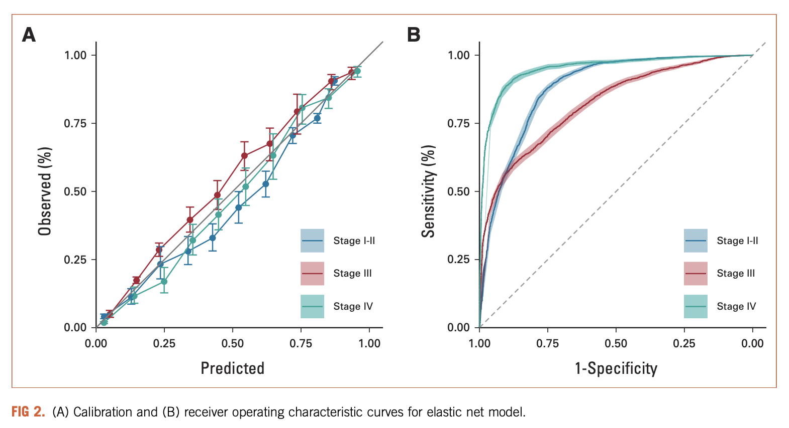

Figure 2,  page 7

**Why stage III is the hardest**
Stage III = lymph nodes touched. Nodes are seen only under the microscope after surgery, and the bills rarely have a code for them. A rule using only the codes found just 33% of stage III. Stage IV is easy because metastases are seen on scans and get a code.

**Top features (SHAP)**
Neoadjuvant therapy, colorectal resection, abdominal nodal disease code, distant metastasis code, oncologist visits, FOLFOX chemo, liver biopsy/resection.

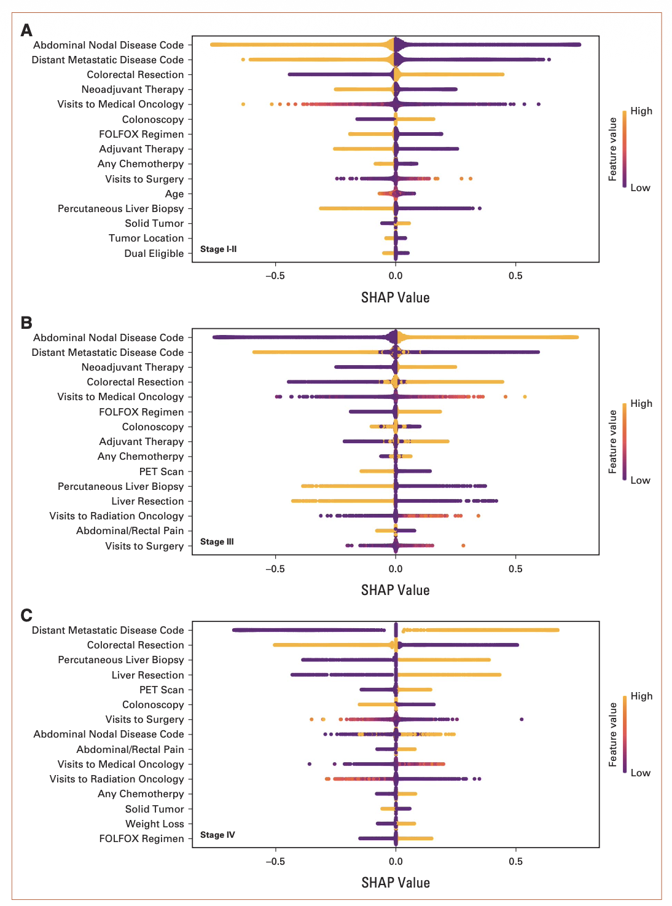

Figure 3, page 8 (SHAP importance plots)

⚠️ **These are not causes, they are consequences of the stage.** Doctors choose the treatment *because* they already know the stage. A "metastasis code" is M1 written another way. A model without treatments did worse. → Fine for Finn (they want to recover the stage afterwards, for research), but for me it would be **leakage**: in my thesis, no treatment and no "after diagnosis" information as input for stage.

**Colon vs rectum**

| | Colon | Rectum |
|---|---|---|
| SBS all stages | 0.49 | **0.31** |
| SBS stage III | 0.36 | **0.14** |

Much better for colon. Finn doesn't explain why. My guess (not from the paper): rectal tumours are often treated *before* surgery, so the claims look different. Also worse for Black and other-race patients (0.41 vs 0.48).

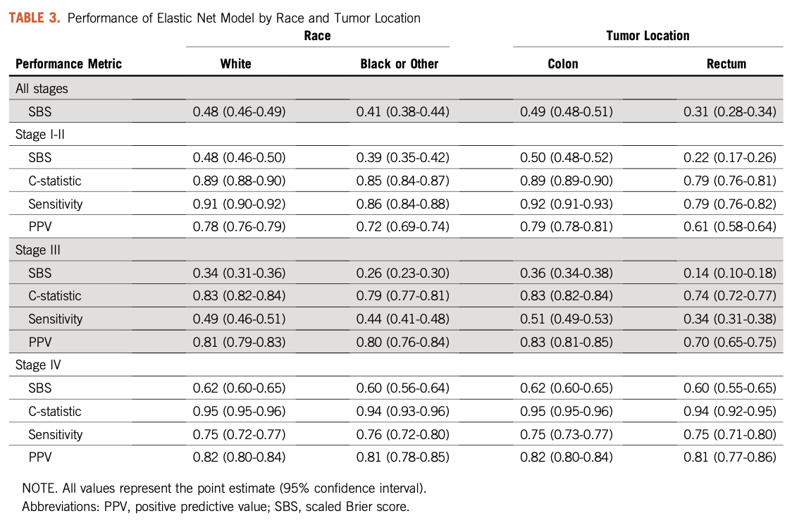

Table 3, page 9 (by race and tumour location)

**Do I trust it?**
- Yes: big cohort, clean temporal validation, good metric, calibration, honest subgroup results, logistic regression compared fairly with random forest.
- Limits: 66+ only, US only; strongest features are almost the answer; they chose class thresholds "by looking at plots".

**How does it help my thesis?**
- Justifies my **3 classes** (same grouping, same reason).
- **Stage III will be my hardest class**, IV the easiest.
- Report **colon and rectum separately**.
- Use the **SBS** too, so I can compare numbers.
- Logistic regression as a baseline: it can be as good as random forest.
- **Do not treat Finn as a score to beat**: their features contain the doctors' staging work. Mine (genes) don't, so a lower score is normal. Say it in the thesis.

##### **C - Related work: stage** - An Eight-CpG-based Methylation Classifier for Preoperative Discriminating Early and Advanced-Late Stage of Colorectal Cancer - Hu et al., Frontiers in Genetics 2021
📄 PDF: `literature/pdf/fgene-11-614160.pdf`
The closest paper on the **genomic** side: TCGA like me, stage as target, no T, N, M as inputs.

**What they did:** predict early (I–II) vs advanced (III–IV) stage from tumour **methylation** (chemical "switches" that turn genes off), plus age and CEA (blood marker). 372 TCGA patients (70/30 split) + 64 from another dataset (GEO) for external validation. From 485,577 methylation sites they kept 8.

**Results**

| Model | TCGA test | External (GEO) |
|---|---|---|
| Methylation alone | 0.730 | **0.702** |
| Methylation + age + CEA | 0.817 | not tested |

CEA was the strongest feature (OR ≈ 6). Methylation stayed useful even with CEA and age in the model. The "high-risk" methylation group also had worse survival (OS, DSS, PFI).

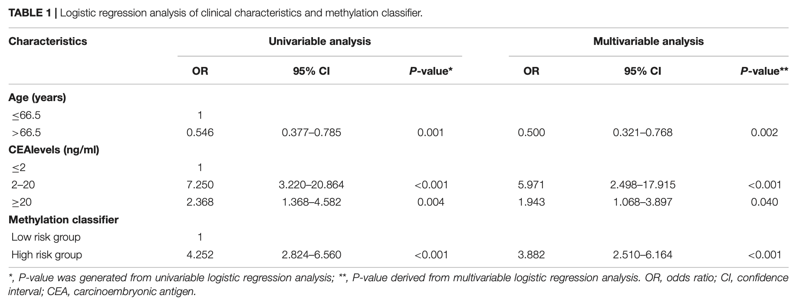

Table 1, page 7

**⚠️ Two problems**
1. **Leakage:** the first feature selection was done on **all patients**, before the train/test split. So the test patients helped choose the features, and 0.730 is too optimistic. GEO (0.702) is the most trustworthy number.
2. **"Preoperative" isn't shown:** methylation was measured on tumours removed by surgery, not on a biopsy.

**For my thesis**
- Genomic data alone ≈ **0.70 AUC** for 2 classes: a modest result is normal.
- Genomic + clinical does better: supports "multimodal".
- Choose features **only on the training data**.
- My gap: Hu = 2 classes, methylation only, leakage. Me = 3 classes, several genomic types + clinical, clean validation, plus survival.

##### **D - Related work: survival** - Development and Validation of a Nomogram to Predict Overall Survival in Stage I–III Colorectal Cancer Patients after Radical Resection with Normal Preoperative Serum CEA - Dai et al., Cancers 2023
📄 PDF: `literature/pdf/cancers-15-05643-v2.pdf`
Same design as my survival model: **stage alone** vs **stage + other features**.

**What they did:** predict overall survival (3 and 5 years) with Cox regression. 1,082 patients from one Shanghai hospital, stage I–III, normal CEA, followed ~6 years. Random 70/30 split, no external validation. Final model: age, grade, pT, pN, and two blood markers (CA242, CA125). Lymph nodes (N) weighed the most.

**Key result (C-index, validation set)**

| Model | C-index |
|---|---|
| Stage alone | **0.593** |
| Their model | **0.702** |

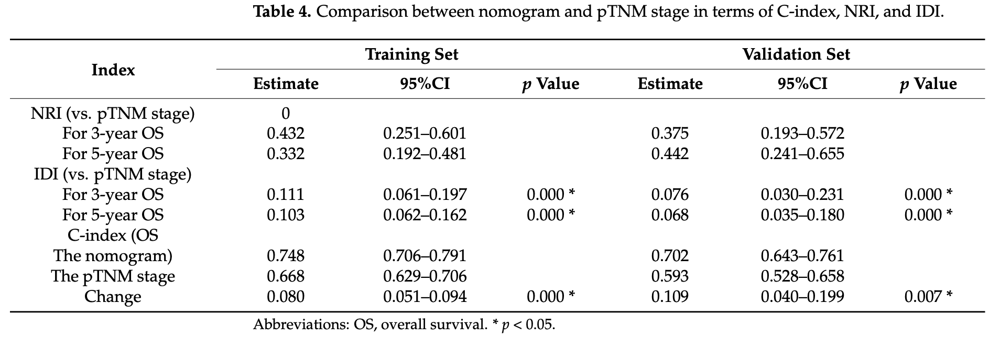

Table 4, page 10

**Careful:** their model uses pT and pN separately, while "stage alone" is one variable. So part of the gain comes from more detailed T and N, not only from the new markers. Also: one hospital only, and they say **BRAF and KRAS were missing**.

**For my thesis**
- Stage alone predicts survival poorly (~0.6): room for genomic features to help.
- Same comparison as my Model 1 vs Model 2, using the **C-index**.
- Keep it fair: the only difference between my two models should be the new features.
- Their missing BRAF/KRAS = my gap.

##### **D - Related work: survival** - Integrative deep learning analysis improves colon adenocarcinoma patient stratification at risk for mortality - Zhou et al., eBioMedicine 2023
📄 PDF: `literature/pdf/PMC10388166.pdf`
The closest paper to my **data**: TCGA colon, clinical and mutation data downloaded **from cBioPortal** (same as me), several types of data combined (multimodal), and SHAP to explain. The difference: they also use **microscope images**, which I don't have.

**What did they want to know?**
Can we sort colon cancer patients into "high risk" and "low risk" of dying better by **combining** different types of data (images + clinical + mutations) than with one type alone?

**What data did they use?**

| Cohort | Patients | Use | Mutations? |
|---|---|---|---|
| TCGA-COAD (colon) | 108 | Training and test (100 random 70/30 splits) | Yes |
| Wayne State University (WSU, Detroit) | 123 | External validation (another hospital) | **No** |
| TCGA-READ (rectum) | 52 | Test: does a colon model work on rectum? | Yes |

- **Clinical features:** age, sex, T, N and M stage (from cBioPortal).
- **Genomic features:** mutation status (yes/no) of the **26 genes mutated in at least 10% of patients** (from 207 genes in cancer pathways), plus **MSI** status.
- **Images:** whole-slide images of the tumour (H&E microscope slides), cut into small tiles and turned into 2,048 numbers per tile by a neural network.

**Target: survival turned into groups**

| Group | Overall survival (OS) | Patients |
|---|---|---|
| High risk | < 3 years | 38 |
| Moderate risk | 3–5 years | 45 |
| Low risk | > 5 years | 25 |
| Censored (left out) | Alive but followed < 3 years | **228** |

- The model is trained **only on high vs low risk** (63 patients). It's a yes/no classification, not a real survival model.
- The moderate patients (3–5 years) are kept aside, then used as a hard test: where does the model put them?
- Censored patients: we know they were alive at their last visit, but not what happened after. Since they can't be put in a group, they were removed from training. **That's 228 of 336 patients (two thirds).**

**How did they combine the data (fusion)?**
For each image tile, they put the image numbers and the patient's clinical + mutation values **side by side in one long list**, then train one neural network on it. This is called **early fusion** (combine the features first, then one model). Patient score = average of the tile scores.

**Results: high vs low risk (AUC, TCGA test)**

| Model | AUC |
|---|---|
| Mutations only | 0.66 |
| Clinical + mutations | 0.69 |
| Clinical only | 0.71 |
| **Images only** | **0.81** |

- **Mutations alone are weak**, and adding them to clinical data **did not help** here (0.69 < 0.71).
- Images are the strongest single type of data.
- But with **all patients** in the test (moderate and censored too), the image-only model failed. The model with **images + clinical + mutations** still separated patients: **C-index 0.69** (± 0.19, very variable).
- **Wayne State** (no mutations): images alone failed, clinical alone was modest, **images + clinical** worked best.
- **Rectum (TCGA-READ):** the models trained on colon could still separate rectal patients when images and clinical data were combined.

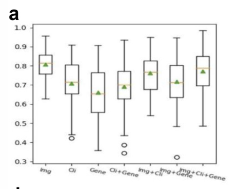

 Fig. 2a, page 5 (AUC of each model)

**Explainability (SHAP)**
- Most important single features: **T stage, M stage and age**. Stage dominates survival again, like in Dai.
- Image features had a higher **total** importance, but only because there are 2,048 of them against 6 clinical variables.
- Clinical alone separated patients poorly, but clinical **with** images worked well. The authors think the two types of data complete each other.
- Note: the SHAP analysis was done on the **images + clinical** model tested on Wayne State, so **mutations are not in it**.
- Pathologists checked the "high-risk" image regions: more tumour cells, bigger abnormal nuclei, fewer immune cells. So the model looks at things that make biological sense.

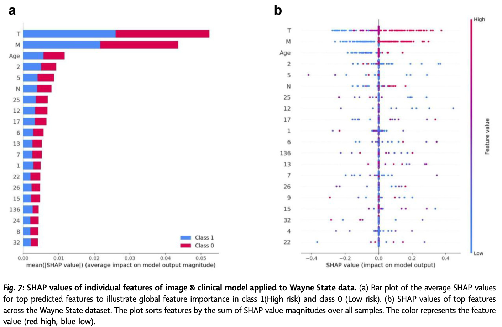

Fig. 7, page 13 (SHAP)

**⚠️ Problems**
1. **Two thirds of the patients are lost.** 228 censored patients were removed. If they are different from the others (for example, diagnosed more recently or healthier), the results are biased.
2. **Survival turned into groups loses information.** "Less than 3 years vs more than 5 years" throws away *when* things happen and all censored patients. Real survival models (Cox, with the C-index) are made exactly to keep both.
3. **Very small training set:** 63 patients. So results jump a lot between splits (AUC ± 0.08 to 0.12, C-index ± 0.19).
4. Their p-values (like 10⁻¹⁹) come from 100 overlapping splits of the same patients, so they look far more significant than they really are.

**Do I trust it?**
- Good practice: external validation in another hospital, colon → rectum test, comparison of each data type alone vs combined, SHAP, pathologist check of the explanations.
- But: tiny sample, survival turned into groups, two thirds of patients removed. The numbers are fragile.

**How does it help my thesis?**
- **Same source, same type of data:** proof that cBioPortal clinical + mutation data can be used for survival in TCGA colon.
- **Copy the gene filter:** genes mutated in ≥ 10% of patients + MSI. Close to my gene list in [[thesis-plan]].
- **Copy the comparison design:** clinical alone / genomic alone / clinical + genomic. That's how I show what "multimodal" adds.
- **Copy the checks:** test colon vs rectum, SHAP on the final model.
- **Expect mutations alone to be weak** (0.66 here). If my genomic features add little, that's an honest result, and Zhou had the same.
- **Do better:** keep the censored patients and the time with a real survival model (Cox, C-index), as planned in [[thesis-plan]]. Zhou had to drop two thirds of TCGA patients; I don't need to.
- **I can't copy the images:** my data has none.

##### **D - Related work: survival** - Comparison of Machine Learning Models for Colon Cancer Survival: Predictive Modeling Approach - Adatorwovor et al., JMIR Cancer 2025
📄 PDF: `literature/pdf/ML-cancer-2025-v11ie72665.pdf`
The only paper in my list that **compares several survival models**. I use it to choose and justify my survival models.

**What they did:** 33,825 colon cancer patients from the Kentucky Cancer Registry (part of SEER), 2010–2022. Features: age, sex, race, smoking, grade, positive lymph nodes, tumour size, insurance, region, **treatment received**, SEER summary stage. Missing data filled by multiple imputation.

**Results: C-index of each model (overall)**

| Model | Type | C-index |
|---|---|---|
| **Random survival forest (RSF)** | ML (many survival trees) | **0.81** |
| Cox | Classic | 0.76 |
| AFT (accelerated failure time) | Classic | 0.76 |
| Elastic net Cox | Penalised Cox | 0.76 |
| LASSO Cox | Penalised Cox | 0.75 |
| XGBoost | ML (boosted trees) | 0.70 |

- Most important features in all models: **positive lymph nodes, treatment, age, tumour size, grade**. Stage-related features dominate again (like Dai and Zhou).
- **LASSO Cox is explainable by itself:** its coefficients are hazard ratios. Example: each extra year of age = +3.5% risk (HR 1.035).
- They used SEER summary stage instead of AJCC TNM, because it is more consistent over the years. Same problem as my mixed AJCC editions.

**Careful:** "treatment received" is used as a feature. That's OK for survival, but it is decided after diagnosis. Their dataset is also 50× bigger than mine: RSF needs a lot of data, so its advantage may be smaller with my ~590 patients.

**For my thesis**
- My survival models: **Cox** (baseline, = Model 1 with stage only), **LASSO / elastic net Cox** (good with few patients and many genes, explainable), **random survival forest** (the ML model to compare).
- Metrics: **C-index** + **Brier score** (calibration over time), like them.
- If RSF beats Cox only slightly on my small data, that's expected.

##### **E - Explainability** - SHAP (Lundberg & Lee 2017; Lundberg et al. 2020) and LIME (Ribeiro et al. 2016) - methods to understand (not read in full)
📄 PDF: `literature/pdf/lundberg2017shap-1705.07874.pdf` (SHAP 2017) · `literature/pdf/nihms-1601475.pdf` (TreeSHAP 2020) · `literature/pdf/ribeiro2016lime-1602.04938.pdf` (LIME)
The two original papers of the explainability methods I will use. They are very mathematical: I need to understand **the idea, how to read the plots, and the limits**, and cite them.

**Why explainability?**
A model can say "this patient is stage IV" without saying **why**. Explainability answers: which features pushed the prediction up or down? In my thesis, that's how I see whether genes (KRAS, BRAF, MSI…) carry stage or survival information. It's the "explainability (features)" part of my title.

**SHAP: the idea**
- Comes from **game theory** (Shapley values): a team wins a prize, how do you share it **fairly** between the players according to what each one brought?
- In ML: the "players" are the **features**, the "prize" is the **prediction**.
- Start from the **baseline** = the average prediction over all patients. Each feature adds or removes a bit. All the contributions **add up exactly** to the prediction for that patient.

*Invented example (just to understand):* average risk of stage IV = 15%. For one patient the model says 40%.

| Feature | SHAP value |
|---|---|
| Baseline (average) | 15% |
| KRAS mutated | +10% |
| Age 45 | +8% |
| Tumour in left colon | +9% |
| MSI-high | −2% |
| **Prediction** | **= 40%** |

- **Local** = explanation for one patient (like the table). **Global** = average over all patients: which features matter the most overall.
- **TreeSHAP** (2020 paper): an exact and fast version for tree models (random forest, XGBoost). For other models SHAP must approximate, which is slower.
- With 3 classes (I–II / III / IV), there is **one set of SHAP values per class** (Finn showed one plot per class).

**How to read the SHAP plots**
- **Bar plot:** average size of each feature's effect → global ranking.
- **Beeswarm / summary plot:** one dot per patient per feature. Position = pushes the prediction up (right) or down (left). Colour = high or low value of the feature. Shows the **direction** of the effect.
- **Dependence plot:** how the SHAP value changes when one feature's value changes (e.g. age).

**LIME: the idea**
- Explains **one patient at a time**.
- It creates many slightly changed copies of the patient, looks at how the model's answer changes, and fits a **simple linear model** around that patient only.
- Result: a short list of features "for" and "against" the prediction.
- **Model-agnostic:** works with any model, because it only looks at the answers.
- Ribeiro's main argument: good accuracy is not enough to trust a model. Explanations can **reveal leakage** (for example, a patient ID that the model uses would show up in the explanation).

**SHAP vs LIME**

| | SHAP | LIME |
|---|---|---|
| Explains | One patient, and globally (average) | One patient |
| Contributions add up to the prediction | Yes, exactly | No, approximate |
| Same result if run again | Yes (TreeSHAP) | Not always (random sampling) |
| Use in my thesis | **Main method** | **Not used**: one sentence in the thesis at most |

**⚠️ Limits (important for the discussion)**
1. **It explains the model, not the disease.** A big SHAP value means "the model uses this feature", not "this gene causes stage IV". If there is leakage, SHAP will happily explain the leak.
2. **Not causal:** association only.
3. **Correlated features** (common with genes: e.g. MSI and BRAF often go together) can share or swap importance, so the ranking can be unstable. *(General knowledge, not from these papers: needs another reference if I write it.)*
4. **Rankings can change between models**: compare SHAP across my models, not just on one.

**For my thesis**
- **My decision:** SHAP only, no LIME. TreeSHAP (`shap.TreeExplainer`) for tree models (random forest, XGBoost); for logistic regression, the coefficients or linear SHAP. Cite Lundberg 2017 + Lundberg 2020.
- Why not LIME: SHAP does everything I need, it's more stable, and one method used well beats two used superficially.
- Show: a global bar plot, a beeswarm plot (direction), and per-class plots for stage.
- Use the explanations as a **leakage check**: if a suspicious feature tops the list, look for the problem.
- Write the limits: model ≠ biology, not causal, correlated genes.

##### **E - Explainability** - Stage-specific cancer survival prediction enriched by explainable machine learning - Poorhasani & Iancu, arXiv 2026 (preprint)
📄 PDF: `literature/pdf/GOAT-2601.03977v1.pdf`
A concrete example of **SHAP (and LIME) applied to colorectal cancer survival**: how to use them, how to show them, and what they tell you. ⚠️ **Preprint**: not peer reviewed, cite it as such.

**What did they want to know?**
Their idea: survival models are usually trained on **all stages together**. But stage alone already separates survivors from non-survivors (91% vs 14%, Siegel), so the model looks good just by "finding the stage". They train **one model per stage** instead, and use SHAP and LIME to see which features matter **inside** each stage.

**What data did they use?**
- SEER, diagnosed 2004–2015. Colorectal: **53,100 patients** (also stomach and liver cancer).
- Stages = SEER summary stages: localized 17,582 / regional 18,884 / distant 16,634.
- 18 clinical features: age, sex, race, tumour size, extension, lymph nodes (positive and examined), metastasis, histology, site, **surgery, radiation**…
- **No genomic data** (SEER doesn't have any).
- Rows with any missing value were removed.

**Target: 5-year survival (yes/no)**
- Survived = alive at 60 months or more.
- Not survived = died **of this cancer** before 60 months.
- Everyone else (alive but followed < 5 years, died of another cause) = **excluded**.

**Models and method**
- Logistic regression, random forest, AdaBoost, CatBoost (a boosted-trees model, like XGBoost).
- Grid search with stratified cross-validation.
- Good practice: **class weights** instead of creating fake patients (SMOTE), and scaling done **inside** the cross-validation (no leakage). (But see van den Goorbergh: class weights may also distort the percentages.)
- SHAP for global explanations, LIME for one patient.

**Results (colorectal, AUC)**

| Stage | Logistic regression | CatBoost (best) |
|---|---|---|
| Localized | 0.81 | 0.82 |
| Regional | 0.76 | 0.81 |
| Distant | 0.82 | 0.86 |

- CatBoost was best everywhere, but **logistic regression was close** (except regional).
- ⚠️ Look at distant stage: accuracy 0.89–0.93 but F1 only 0.16–0.45. Few patients survive 5 years at distant stage, so a model that says "dies" for everyone already gets high accuracy. **That's why accuracy is a bad metric when classes are unbalanced** (same lesson as Finn).

**What SHAP showed (colorectal)**
- The important features **change with the stage**:
  - **Localized:** surgery, tumour size, extension, age.
  - **Regional:** age, extension, **lymph nodes** (positive, examined), radiation.
  - **Distant:** age, surgery, lymph nodes still important.
- LIME found a strange signal: "regional nodes positive = **98**", a SEER code that means "**nodes not examined**". It predicts worse survival, probably because those patients didn't get a full surgery. That's a **data-recording pattern**, not biology. Good example of explanations revealing something about how data were collected.
- The authors' own conclusion: explainability mostly **confirms known factors** (age, surgery, size, nodes). Its value is to check that the model reasons in a clinically sensible way, not to discover new things.

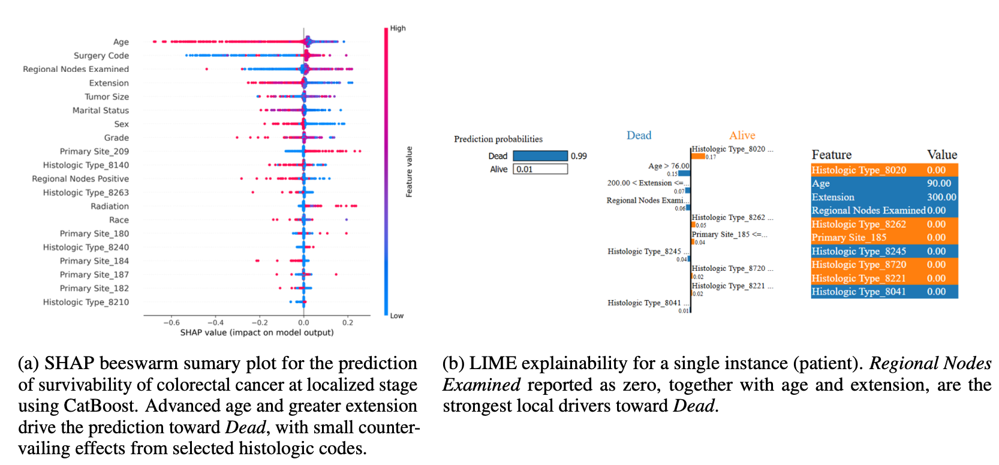

Figure 6, page 8 (SHAP beeswarm + LIME for one patient)

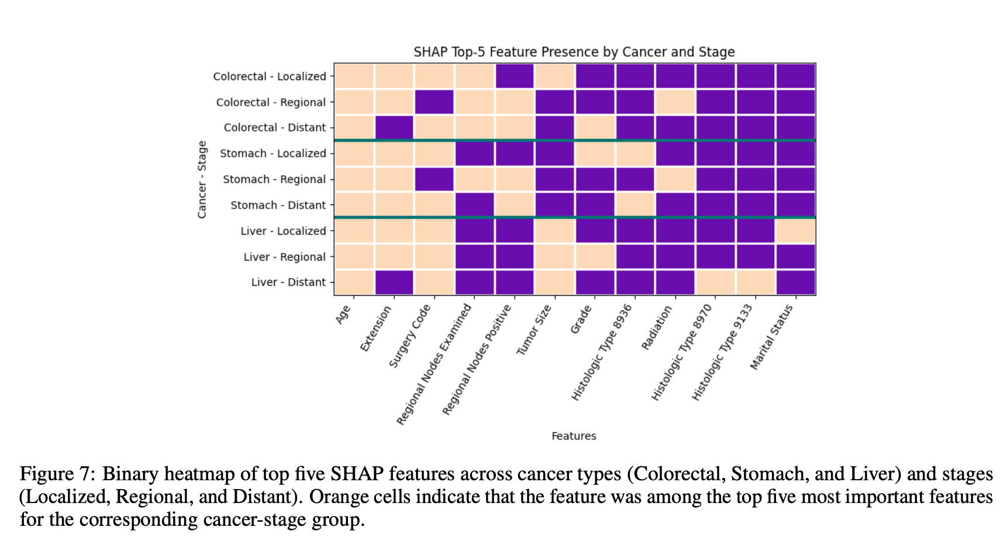

Figure 7, page 8 (top 5 SHAP features per stage)

**⚠️ Problems**
1. **Their main claim isn't tested:** they say all-stages models "overestimate" performance, but they never show the all-stages model's numbers to compare.
2. **Many patients excluded:** rows with any missing value, plus everyone alive with < 5 years of follow-up. Same problem as Zhou (censored patients removed), and survival turned into yes/no.
3. **Treatment as a feature** (surgery, radiation): the explanations partly say "who was fit enough to be treated".
4. Preprint, SEER only, no external validation.

**How does it help my thesis?**
- **The key idea for my survival part: stage dominates, so check what genes add *beyond* stage.** That's my Model 1 (stage) vs Model 2 (stage + clinical + genomic). An extra option: look at SHAP inside each stage group (but with ~590 patients, groups get small).
- **How to present SHAP:** beeswarm plot + top features per group, like their Figures 6–7.
- **Good practice to copy:** no SMOTE, preprocessing inside the cross-validation, logistic regression as baseline. (Class weights: careful, see van den Goorbergh.)
- **Use SHAP as a sanity check:** if a weird feature comes out on top (like their "code 98"), look at how the data were recorded before talking about biology.
- They used LIME too: it's the example for my one sentence "LIME exists, but I chose SHAP because…".

##### **F - Methods** - Leakage and the reproducibility crisis in machine-learning-based science - Kapoor & Narayanan, Patterns 2023
📄 PDF: `literature/pdf/pmc_10499856.pdf`
**The most important methods paper for my thesis.** It gives the name and the list of the mistake I must avoid the most: **leakage**.

**What is leakage?**
The model gets information during training that it **should not have**, like information from the test set, or a feature that is the answer in disguise. Result: the score looks great, but it would fail on new patients. Like a student who saw the exam questions before the exam.

**What did they find?**
- 22 review papers from **17 fields** (medicine, genomics, political science…) found leakage in at least **294 published papers**.
- Case study: civil war prediction. Papers said complex ML was much better than logistic regression. After fixing the leakage, **ML was no better than logistic regression**.

**The 3 types of leakage (their list)**

| Code | Type | Plain meaning | Seen in my papers |
|---|---|---|---|
| **L1** | **No clean train/test separation** | The test set "leaks" into training | |
| L1.1 | No test set | Test on the same data used for training | |
| L1.2 | Preprocessing on all data | Filling missing values, scaling, oversampling (SMOTE)… done **before** the split | Ahn, Qiu (to check) |
| L1.3 | Feature selection on all data | Choosing the best features using **all** patients, test included | **Hu** (CpGs chosen before the split) |
| L1.4 | Duplicates | The same patient/sample in train and test | |
| **L2** | **Illegitimate features** | A feature that is the answer in disguise, or that you wouldn't have at prediction time. Their example: using "takes blood pressure drugs" to predict high blood pressure | **Finn** (treatments) if used to predict stage |
| **L3** | **Test set not like the real use** | The test doesn't represent the patients you make claims about | |
| L3.1 | Temporal leakage | Using data "from the future" | |
| L3.2 | Non-independence | Train and test not independent (e.g. same patient in both) | |
| L3.3 | Sampling bias | Test patients not representative (one place, one selected group) | |

- For L2, they say there is no fixed rule: **I must justify each feature with domain knowledge**.
- **Model info sheet:** 21 questions to answer to prove there is no leakage (clean split? each feature legitimate? test set representative?). I could fill one in for my thesis.

**My leakage checklist (from this paper)**

| Risk | In my thesis | What I do |
|---|---|---|
| **L2** illegitimate features (stage model) | `PATH_T_STAGE`, `PATH_N_STAGE`, `PATH_M_STAGE`, stage, treatment, survival columns | **Removed** from the stage model (see [[thesis-plan]]) |
| **L1.3** feature selection | Thousands of genes / mutations | Choose features **only on the training folds**, inside cross-validation |
| **L1.2** preprocessing | Missing values, scaling | Fit them **inside** the cross-validation pipeline. No SMOTE, no oversampling (van den Goorbergh) |
| **L1.4 / L3.2** duplicates | TCGA can have several samples per patient | **One row per patient** |
| **L3.3** sampling bias | TCGA patients were chosen for tissue quality, mostly US | Write it as a **limitation** |

**For my thesis**
- Gives the **exact words** to explain why I don't use T, N, M for stage: it's **L2 leakage** (illegitimate feature).
- Gives a **lens to criticise** the related work: Hu = L1.3, Ahn/Qiu = possible L1.2, Finn's features = L2 for my purpose.
- Supports using **logistic regression as a baseline**: when leakage is fixed, the gap with complex ML often disappears.
- Filling in a **model info sheet** is a simple, citable way to show my work is clean.

##### **F - Methods** - A systematic review shows no performance benefit of machine learning over logistic regression for clinical prediction models - Christodoulou et al., J Clin Epidemiol 2019
📄 PDF: `literature/pdf/PIIS0895435618310813.pdf`
Answers a simple question: **is machine learning really better than logistic regression for medical prediction?** Short answer: **no, not when the study is done properly.**

**What did they do?**
A **systematic review**: they collected all studies (2016–2017, Medline) that compared logistic regression (LR) with ML models (random forest, neural networks, SVM, trees…) to predict a yes/no outcome in medicine. 71 studies out of 927, with **282 comparisons** LR vs ML. For each comparison they checked if the method was clean or at risk of bias (for example a bad validation).

**Results**

| Comparisons | Number | ML vs LR |
|---|---|---|
| **Low risk of bias** (clean method) | 145 | **No difference** (0.00) |
| **High risk of bias** (doubtful method) | 137 | ML looks better (+0.34) |

- The difference is measured on the logit(AUC) scale. To give an idea: +0.34 turns an AUC of 0.75 into about 0.81.
- So **ML only "wins" in the badly done studies**. Same message as Kapoor: fix the method and the ML advantage disappears.
- Single decision trees were the worst. The other ML models were similar to each other.

**Other findings: how bad studies were**
- 68% of studies had a doubtful validation.
- 90% used the AUC, but **79% never checked calibration** (whether the predicted percentages are right).
- Only one study checked if the model is clinically useful.

**Do I trust it?**
- Yes: strong authors in prediction methods (Collins, Steyerberg, Van Calster), clear and honest method.
- Limits: only yes/no outcomes, only 2016–2017, and **studies with high-dimensional data (like genomics) were excluded**. So it doesn't say for sure what happens with my genes.

**What I've already seen in my papers**

| Paper | LR vs ML |
|---|---|
| Finn | Equal (SBS 0.44 vs 0.46) |
| Wei | Equal |
| Poorhasani | LR close to CatBoost |
| Ahn | ML 0.99 vs LR 0.62 → suspicious, possible leakage |
| Qiu | ML 0.92 vs LR ~0.70 → suspicious (SMOTE) |

The clean studies show LR ≈ ML; the big gaps come from studies with doubtful methods. Exactly what Christodoulou found.

**For my thesis**
- **My focus is ML** (random forest, XGBoost…). Logistic regression is only the **baseline**: one row in my results table, to show what ML adds. LR is itself a basic supervised ML model (it's in scikit-learn), so this stays inside ML.
- **Don't expect ML to win.** If random forest or XGBoost beats LR by a lot, first look for a problem (leakage, bad validation).
- If LR ≈ ML in my results, that's a normal and valid result, and I can cite this paper.
- Their checklist for my methods chapter: describe every step, do all steps inside the cross-validation, report training **and** test results, and **check calibration**.

##### **F - Methods** - The harm of class imbalance corrections for risk prediction models: illustration and simulation using logistic regression - van den Goorbergh et al., JAMIA 2022
📄 PDF: `literature/pdf/ocac093.pdf`
Answers: **should I "fix" unbalanced classes** (e.g. stage IV is only ~15% of my patients) with SMOTE or oversampling? **Short answer: no.**

**What is class imbalance?**
One class is much rarer than the others. In my data: stage I–II 324, III 170, **IV only 86**. Many papers think the model will "ignore" the rare class, so they **rebalance** the data:
- **Undersampling:** remove patients from the big class.
- **Oversampling:** copy patients from the rare class.
- **SMOTE:** create **fake** patients for the rare class, by mixing real ones.

**What did they do?**
They tested these 3 corrections against **no correction**, with logistic regression (normal and penalised):
- on real data: 3,369 patients with an ovarian tumour (20% malignant);
- on simulations: many scenarios with 30%, 10% and 1% of events, and different sizes.

**Results**

| | No correction | Under / oversampling, SMOTE |
|---|---|---|
| AUC (separating the classes) | Same or better | **Never better**, sometimes worse |
| Calibration (are the % right?) | Good | **Very bad**: the risk of the rare class is strongly **overestimated** |
| Balance sensitivity / specificity | Same result by **moving the threshold** | Better than with threshold 0.5, but nothing more |

- In other words: correcting doesn't help the model to separate classes. It only **shifts the predicted percentages** upwards for the rare class, so they become wrong.
- If you want to find more rare-class patients, you get the same effect by simply **lowering the decision threshold** (e.g. say "stage IV" from 30% instead of 50%), without damaging the probabilities.
- Their conclusion: **class imbalance is not a problem in itself**, and correcting it can make the model worse.

**Do I trust it?**
- Yes: strong authors (Van Calster, van Smeden), real data + big simulations.
- Limits: only logistic regression and yes/no outcomes. They did **not** test random forest, XGBoost, or **class weights**. But they expect miscalibration with **any** correction method, unless the model is recalibrated afterwards.

**What it changes in my notes**
- Ahn and Qiu used oversampling / SMOTE → their probabilities are probably wrong, on top of the possible leakage.
- Poorhasani used **class weights** instead of SMOTE. Better than fake patients (no L1.2 leakage), but this paper suggests class weights may **also** distort the percentages. Not "free".

**For my thesis**
- **Train on the real class distribution** (324 / 170 / 86). No SMOTE, no oversampling.
- If stage IV is missed too often, **move the decision threshold** instead of rebalancing.
- My main metric (scaled Brier score, like Finn) and the calibration plots depend on correct **percentages**: one more reason not to rebalance.
- If I try class weights anyway, check calibration afterwards.
- Use accuracy carefully: with unbalanced classes it can look good while the rare class is missed (Poorhasani distant stage: accuracy 0.89, F1 0.16–0.45).

##### **F - Methods** - Calibration: the Achilles heel of predictive analytics - Van Calster et al., BMC Medicine 2019
📄 PDF: `literature/pdf/s12916-019-1466-7.pdf`
Explains **calibration**: the second thing to check in a model, after the AUC. Christodoulou found that 79% of studies never checked it.

**AUC vs calibration: two different questions**

| | Question | Example |
|---|---|---|
| **Discrimination** (AUC, C-index) | Does the model give **higher** risks to patients who have the event? | Ranks stage IV patients above the others |
| **Calibration** | Are the **percentages right**? | When the model says "30% stage IV", about 30 out of 100 such patients really are stage IV |

A model can have a **good AUC but bad calibration**: it ranks patients well, but its percentages are wrong (for example all too high). For a doctor, a wrong "30%" can lead to a wrong decision. Their example: a model for IVF success that overestimates the chance of a baby gives false hope.

**The 4 levels of calibration**
1. **Mean:** the average predicted risk = the real event rate.
2. **Weak:** **calibration intercept** (should be **0**) and **calibration slope** (should be **1**).
   - Slope **< 1** = predictions **too extreme** (too close to 0% and 100%) → typical sign of **overfitting**.
   - Slope > 1 = predictions too timid.
   - Intercept ≠ 0 = all predictions too high or too low.
3. **Moderate:** the **calibration curve** (predicted % vs observed %) follows the diagonal.
4. **Strong:** perfect for every type of patient. Impossible in practice.

**Why models are badly calibrated**
- **Overfitting:** too many features or too complex a model for the number of patients.
- Different population or period from the training data.
- Measurement differences between hospitals.

**Practical rules**
- **Don't use the Hosmer–Lemeshow test** (Hu used it).
- A good calibration curve needs about **200 patients with the event and 200 without**. With fewer, report only **intercept and slope**.
- To prevent problems: choose the method in advance, keep the model as simple as the data allow, use **penalisation** (LASSO, ridge, elastic net).

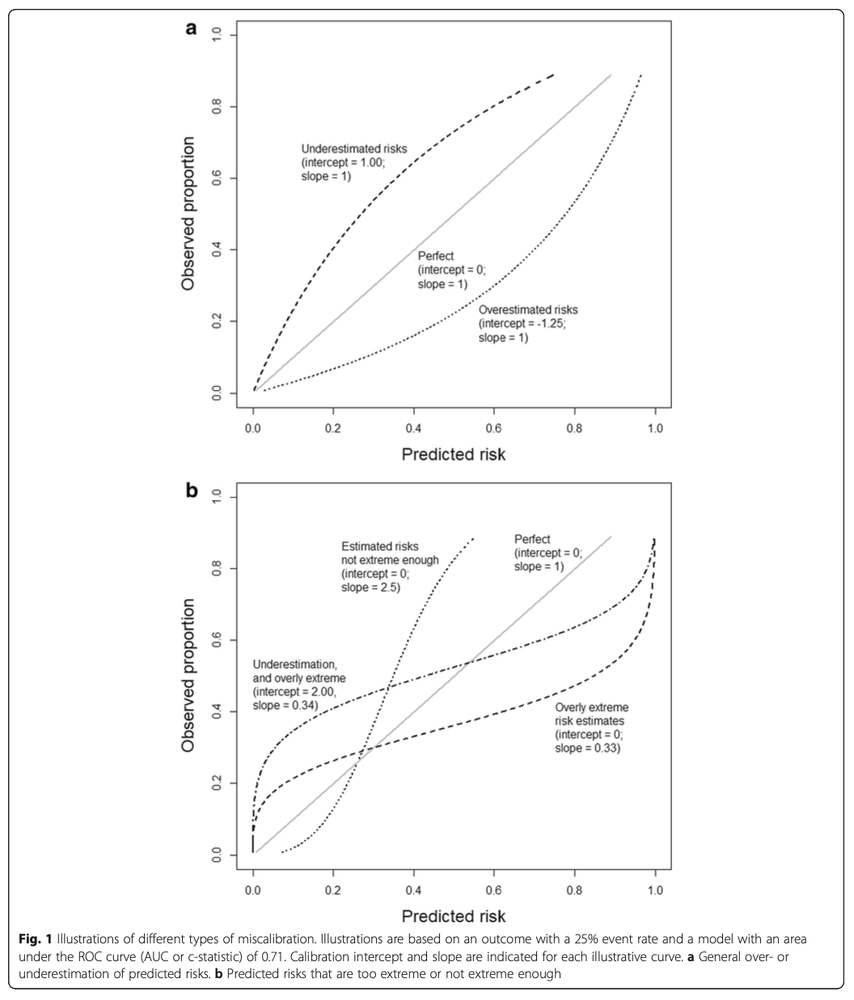

Figure 1, page 3 (examples of calibration curves)

**Do I trust it?**
Yes: written by the leading people on prediction model methods (Van Calster, Steyerberg, Collins…). It's an opinion/tutorial article, not an experiment. Written for yes/no outcomes: for my 3 stage classes, calibration is checked **per class** (e.g. stage IV vs the rest).

**For my thesis**
- Report **calibration for every model**, not only AUC / C-index: calibration slope and intercept, and curves where possible.
- **My data is small:** stage IV = 86 patients, far below 200 → calibration curves will be noisy. Report intercept and slope, and say it.
- **Complex ML models overfit more easily** on ~590 patients → a calibration slope < 1 will show it. Penalisation and simple settings help.
- Links: SMOTE ruins calibration (van den Goorbergh); the scaled Brier score (Finn) mixes discrimination and calibration.

##### **F - Methods** - TRIPOD+AI statement: updated guidance for reporting clinical prediction models that use regression or machine learning methods - Collins et al., BMJ 2024
📄 PDF: `literature/pdf/bmj-2023-078378.full.pdf`
Not a study: a **checklist** of what to write when you publish a prediction model, for **regression and machine learning**. It replaces TRIPOD 2015. I use it **when writing** the methods and results chapters, so I don't forget anything.

**What is it?**
- **27 main items** (52 sub-items) + a 13-item checklist for the abstract.
- It covers the whole paper: title, abstract, introduction, methods, open science (data and code), results, discussion.
- Each item is marked D (model **development**), E (**evaluation**) or D;E (both).
- It says **what to report**, not how to build the model. A study can tick every box and still be bad.

**The items that matter most for me**

| Item | What to write | In my thesis |
|---|---|---|
| 5–6 | Data source, dates, setting, who is included | TCGA PanCancer Atlas via cBioPortal, 594 patients, colon + rectum, exclusions |
| 8 | Exact **outcome** and time horizon | Stage I–II / III / IV; PFI (main) and OS (second) |
| 9 | Which **predictors**, why, and **when they are measured** | Clinical + genomic, no T/N/M, no treatment (= the leakage question) |
| 10 | Why the **sample size** is enough | ~590 patients, 86 stage IV, 150 PFI events: justify and admit the limit |
| 11 | How **missing data** were handled | e.g. 66 patients without mutation data |
| 12 | How data were split, preprocessing, model types, tuning, validation, **metrics (discrimination, calibration…)** | Cross-validation pipeline, LR baseline + RF / XGBoost, SBS, AUC, C-index, calibration |
| 13 | Any **class imbalance** method, and recalibration | None (van den Goorbergh) |
| 14 | **Fairness** | e.g. results colon vs rectum, by sex |
| 18e–f | **Data and code** available | TCGA data is public; share my code |
| 20 | **Flow of patients** (how many at each step, with and without the outcome) | A flow chart: 594 → after exclusions → per class |
| 23 | Performance **with confidence intervals**, also for subgroups | e.g. bootstrap CIs (like Finn) |
| 26 | **Limitations** (overfitting, non-representative data…) | Small data, TCGA selection, short follow-up |

**Do I trust it?**
Yes: the official international guideline (EQUATOR network, Collins, Moons, Van Calster…). Finn and Adatorwovor said they followed TRIPOD.

**For my thesis**
- Use it as the **plan of my methods and results chapters**, and maybe put the completed checklist in an appendix.
- Gives a reference for "optional-looking" things: calibration, confidence intervals, missing data, sample size, code sharing.
- Item 9 ("when predictors were measured") is the writing side of leakage (Kapoor): for stage, only information that exists **before** stage is known.
- My thesis is exploratory (not a tool for doctors): say it, and apply the items that fit.

---------

##### **Synthesis** - What all my papers say together
1. **Stage decides survival** (91% → 14%, Siegel). Survival models with stage mostly rediscover stage (Dai, Zhou, Poorhasani). → Check what genes add **beyond** stage.
2. **TCGA stage mixes AJCC editions** (Liu CDR, Amin). → Keep only the big groups I–II / III / IV.
3. **Stage is made from T, N, M**, so using them (or treatment, survival) to predict stage is circular = **L2 leakage** (Kapoor). → The real question: do non-staging data (clinical + genomic) predict stage?
4. **Most ML papers predict one part of stage** (N: Ahn; M: Wei, Qiu). Few predict the full stage (Finn, Hu). None on TCGA does 3 classes.
5. **Clinical + genomic are rarely combined well.** SEER has no genes (Wei, Dai say it). Hu combined them but with leakage and only 2 classes. → **My gap.**
6. **Very high scores are often suspicious** (Ahn 0.99, Qiu 0.92: oversampling / SMOTE). When done properly, logistic regression ≈ ML (Christodoulou, Finn, Wei).
7. **The method rules are clear:** split first, all preprocessing inside the cross-validation (Kapoor); a simple baseline (Christodoulou); no SMOTE (van den Goorbergh); report calibration (Van Calster); write with TRIPOD+AI.
8. **Explainability:** SHAP is the standard (Finn, Qiu, Zhou, Poorhasani). It explains the model, not the disease, and rankings can change between models.
9. **My data is small:** 594 patients, 86 stage IV, no tumour grade, follow-up < 2 years (Liu CDR). → Short list of known genes + MSI/subtype (TCGA 2012, Liu Y), not thousands of variables.
10. **Genes are linked to stage** (TCGA 2012), and the AJCC wants molecular factors to complement stage (Amin). → My question is well motivated.

#### Dictionary
- **IARC (International Agency for Research on Cancer):** World Health Organization cancer agency in Lyon, which makes GLOBOCAN
- **GLOBOCAN:** IARC database of cancer cases and deaths for every country
- **Transitioned vs transitioning countries:** Roughly rich / developing countries
- **Burden:** the weight of a disease on a population (cases and deaths)
- **HDI:** Human Development Index: how developed a country is (health, education, income)
- ASR: Age standarization rate.
- **incidence rate / (ASR):** New cases per 100,000 people, adjusted for age, so countries can be compared fairly
- **cumulative risk:** Chance of getting the cancer before age 75
- **estimate:** A calculated number, not an exact count
- **Microbiome:** The bacteria living in your gut

- **Stage at diagnosis:** means the stage the cancer had when it was first found and examined. The stage doesnt change event if there is progress of the cancer.
- **incidence:** Number of new cases
- **mortality:** Number of deaths

- **Lymph node:** Small "filters" of the immune system near the bowel, cancer often goes there first 
- **Peritoneum:** The thin layer that lines the belly and covers the bowel                      
- **Micrometastasis:** A very small group of cancer cells in a lymph node
- **Tumour deposit:** A small cancer nodule near the bowel, not inside a lymph node     
- **KRAS, BRAF, NRAS, MSI:** Genetic markers of the tumour, that's genomic data

- **Personalised approach:** Treat each patient according to their own tumour, not only their stage
- **Somatic mutation:** A DNA error only in the tumour, not inherited
- **Germline mutation:** A DNA error inherited from the parents, present in every cell of the body
- **Mismatch repair (MMR) deficiency:** The cell's DNA "spell-checker" is broken, so the tumour piles up lots of errors
- **Microsatellite instability (MSI):** The measurable sign that the spell-checker is broken. It's a test result: MSI-high or not
- **RAS pathway:** KRAS, NRAS, BRAF: Genes that work like the cell's accelerator pedal. When mutated, the pedal is stuck down and the cell keeps growing
- **Site-specific factors:** Extra information recorded for this cancer type. It's written in the file but not used to calculate the stage 

- **Prognosis:** What will probably happen to the patient (survive or not, how long)
- **Prognostic factor:** Something that helps predict that (e.g. stage, age)
- **Anatomic stage:** Stage based only on the body (T, N, M)
- **Prognostic stage group:** Stage based on T, N, M plus other factors (markers, grade…)
- **Population-based vs personalised:** Same answer for everyone in a group vs an answer adapted to each patient
- **Levels of evidence:** How strong the proof is behind a rule (1 = strongest, 4 = weakest)
- **Precision medicine:** Treatment based on the patient's own tumour (same idea as personalised)
- **CEA (carcinoembryonic antigen):** A blood test (tumour marker) used in colon cancer

- **Review:** An article that summarises other studies, without its own experiment
- **Proximal / right colon:** The start of the colon (right side of the belly)
- **Distal / left colon:** The end of the colon (left side), just before the rectum
- **Sidedness:** Which side the tumour is on, right or left
- **CMS (consensus molecular subtypes):** 4 "families" of colorectal cancer based on their genes (CMS1 to CMS4)
- **Neoadjuvant therapy:** Treatment (chemo, radiotherapy) given before surgery

- **Exome sequencing:** Reading the DNA of all genes in the tumour to find mutations
- **Tumour–normal pair:** Comparing the tumour DNA with healthy DNA from the same patient
- **Hypermutated:** A tumour with a huge number of mutations (often because the DNA "spell-checker" is broken, so MSI)
- **CIN (chromosomal instability):** A tumour where mostly big pieces of chromosomes are lost or duplicated
- **Significantly mutated gene:** A gene mutated much more often than by chance
- **Pathway:** A chain of genes working together, like a production line
- **CIMP:** A tumour with a lot of methylation (many gene "switches" turned off)
- **POLE:** A gene that copies DNA; when mutated, the tumour becomes hypermutated

- **Data resource paper:** An article that describes and cleans a dataset, without its own prediction
- **Curation:** Cleaning and checking data
- **Endpoint:** What the model predicts (the event that is counted)
- **Event:** The patient had the thing we count (death, relapse...)
- **Follow-up:** How long the patient was followed
- **Median follow-up:** Half the patients were followed less than this time, half more
- **OS / DSS / PFI / DFI:** The 4 types of survival (see the table in Liu CDR)
- **Tumour grade:** How abnormal the cancer cells look under the microscope (not in TCGA colorectal)

- **PanCancer Atlas:** TCGA project that analysed all 33 cancers together (2018); the name of my dataset
- **cBioPortal:** Website to download and explore cancer genomic data
- **Z-score:** A value rescaled to show how far it is from the average (in standard deviations)

- **Medicare claims:** Bills sent to the US public insurance for people 65+. They list diagnoses, exams and treatments, but not the stage
- **SEER-Medicare:** SEER registry (which has the stage) linked to the Medicare bills of the same patients
- **Risk adjustment:** Taking into account how sick patients are when comparing hospitals or treatments
- **Multinomial logistic regression:** Logistic regression for more than 2 classes
- **Elastic net:** Logistic regression that shrinks unhelpful features towards zero, so the model stays simple
- **Brier score:** Error of the predicted percentages (smaller = better)
- **Scaled Brier score (SBS):** Brier score compared to a "dumb" model: 0 = no better than guessing the class proportions, 1 = perfect
- **Feature:** One piece of information given to the model for each patient (age, sex, KRAS mutated yes/no…). Like a column in my data table. The model uses the features to predict the target (stage or survival)
- **Target:** What the model must predict (here: stage, or survival)
- **AUC (area under the ROC curve):** How well the model **separates** two groups (e.g. early vs advanced stage). Take one patient from each group at random: AUC = the chance the model gives the higher score to the right one. 0.5 = coin toss, 0.7 = modest, 0.8 = good, 0.9+ = very good (or suspicious, check for leakage). Example: AUC 0.70 = the model ranks the pair correctly 7 times out of 10
- **ROC curve:** The graph behind the AUC: for every threshold, it plots how many real cases are found (sensitivity) vs how many false alarms (1 − specificity). The AUC is the area under this curve
- **C-statistic:** Same thing as AUC: how well the model ranks a patient with the class above one without it (0.5 = random, 1 = perfect)
- **Calibration:** When the model says 30%, does it really happen 30% of the time?
- **Sensitivity:** Of the real stage III patients, how many the model finds
- **PPV (positive predictive value):** When the model says stage III, how often it is right
- **Temporal validation:** Train on older patients, test on newer ones
- **Adjuvant therapy:** Treatment given after surgery (opposite of neoadjuvant)
- **Resection:** Surgery that removes the tumour
- **FOLFOX:** A standard chemotherapy combination for colorectal cancer

- **DNA methylation:** A chemical mark on the DNA that turns a gene off, without changing the DNA letters
- **CpG:** A spot on the DNA where methylation can happen; measured from 0 (off) to 1 (fully methylated)
- **Beta value:** The methylation level of a CpG, from 0 to 1
- **GEO (Gene Expression Omnibus):** Public database of genomic datasets
- **External validation:** Testing the model on patients from a different dataset
- **Univariable:** One feature tested alone
- **Multivariable:** Several features together in one model
- **LASSO:** Logistic regression that sets useless features to exactly zero, so only a few are kept
- **Odds ratio (OR):** How many times more likely the outcome is compared to the reference group (OR 1 = no difference)
- **Nomogram:** A chart that turns a regression model into points, so a doctor can calculate a risk by hand
- **Biopsy:** A small piece of tumour taken before surgery
- **Log-rank test:** Test that checks if two survival curves are different

- **XGBoost:** A strong tree-based model (many small decision trees, each one fixing the errors of the previous ones)
- **SMOTE:** Creates fake extra patients for the rare class to balance the data. Must be done only on the training data, otherwise it leaks

- **Cox regression:** The classic survival model; it uses both whether the event happened and when
- **Hazard ratio (HR):** How many times more risk of the event at any moment, compared to the reference group (HR 1 = no difference)
- **C-index (concordance index):** The AUC of survival: does the model give the higher risk to the patient who has the event first? 0.5 = random, 1 = perfect
- **NRI / IDI:** Tools that check whether a new model classifies patients better than an old one (> 0 = better)
- **Decision curve analysis (DCA):** Checks if using the model would help doctors make better decisions
- **Stepwise selection:** Adding/removing features one by one to find a "best" set (not recommended today: unstable)
- **Radical resection:** Surgery that removes the whole tumour with a safety margin
- **CA125, CA242:** Other blood tumour markers, like CEA

- **Whole-slide image (WSI):** A digital photo of a tumour slice under the microscope
- **H&E:** The standard pink/purple stain used on tumour slices
- **Tile:** A small square cut from a big slide image
- **Censored patient:** A patient followed for a while and still alive at the last visit; we don't know what happened after
- **Early fusion:** Put all features (images, clinical, genes) side by side first, then train one model
- **Deep learning / neural network:** A model made of many layers that learns its own features (used here for images)
- **External validation cohort:** Patients from another hospital, used only for testing

- **Random survival forest (RSF):** A random forest adapted to survival data (keeps time and censored patients)
- **AFT (accelerated failure time):** A classic survival model that predicts how much faster or slower the event happens
- **Multiple imputation:** Filling missing values several times with plausible guesses, then combining the results

- **Explainability:** Methods that show why a model made its prediction
- **Shapley value:** From game theory: a fair way to share a result between players according to what each brought
- **SHAP value:** How much one feature pushed one patient's prediction up or down, compared to the average
- **Baseline (SHAP):** The average prediction over all patients, the starting point of the explanation
- **Local / global explanation:** For one patient / for the whole dataset
- **Beeswarm plot:** SHAP plot with one dot per patient per feature, showing size and direction of the effect
- **Model-agnostic:** Works with any type of model
- **LIME:** Explains one prediction by fitting a simple model around that one patient

- **Preprint:** An article put online before (or without) peer review
- **CatBoost / AdaBoost:** Boosted-tree models (many small trees, each correcting the previous ones), like XGBoost
- **Class weights:** Giving more importance to the rare class during training, instead of creating fake patients
- **F1 score:** A mix of sensitivity and precision for one class; low when the model misses the rare class
- **Stratified cross-validation:** Cross-validation where each fold keeps the same class proportions

- **Data leakage:** The model gets information during training that it should not have, so the score is too optimistic
- **Illegitimate feature:** A feature that is the answer in disguise, or not available when the prediction is made
- **Model info sheet:** A list of 21 questions (Kapoor) to show a model has no leakage
- **Pipeline:** The chain of steps (fill missing values, scale, select features, train) run together inside each cross-validation fold
- **Reproducibility:** Other people can redo the study and get the same result

- **Systematic review:** A study that collects and compares all published studies on a question, with a fixed method
- **Risk of bias:** How likely a study's method makes its results wrong (e.g. bad validation)
- **Baseline model:** The simple reference model that more complex models must beat
- **SVM (support vector machine):** An ML model that separates classes with a boundary

- **Class imbalance:** One class is much rarer than the others (e.g. stage IV vs I–II)
- **Undersampling / oversampling:** Removing patients from the big class / copying patients from the rare class
- **Decision threshold:** The probability from which the model says "yes" (default 0.5; can be moved)
- **Recalibration:** Correcting a model afterwards so its percentages become right again

- **Discrimination:** How well the model ranks patients with the event above those without (AUC, C-index)
- **Calibration curve:** Graph of predicted % vs observed %; a perfect model follows the diagonal
- **Calibration slope:** Should be 1; below 1 = predictions too extreme (overfitting)
- **Calibration intercept:** Should be 0; above or below = predictions too low or too high overall
- **Overfitting:** The model learns the noise of the training data, so it does worse on new patients
- **Penalisation:** Adding a cost for complexity (LASSO, ridge) so the model stays simpler and overfits less

- **Reporting guideline:** A checklist of what a paper must describe so others can judge and reproduce it
- **TRIPOD:** The reporting guideline for prediction models (TRIPOD+AI = 2024 version, also for ML)
- **Flow chart (patients):** Diagram showing how many patients remain after each exclusion step
- **Confidence interval (CI):** The range in which the true value probably lies (e.g. AUC 0.70, 95% CI 0.62–0.78)
- **Bootstrap:** Resampling the patients many times to estimate how much a result could vary
